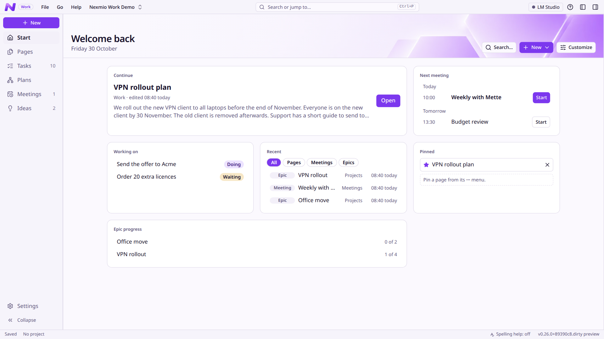
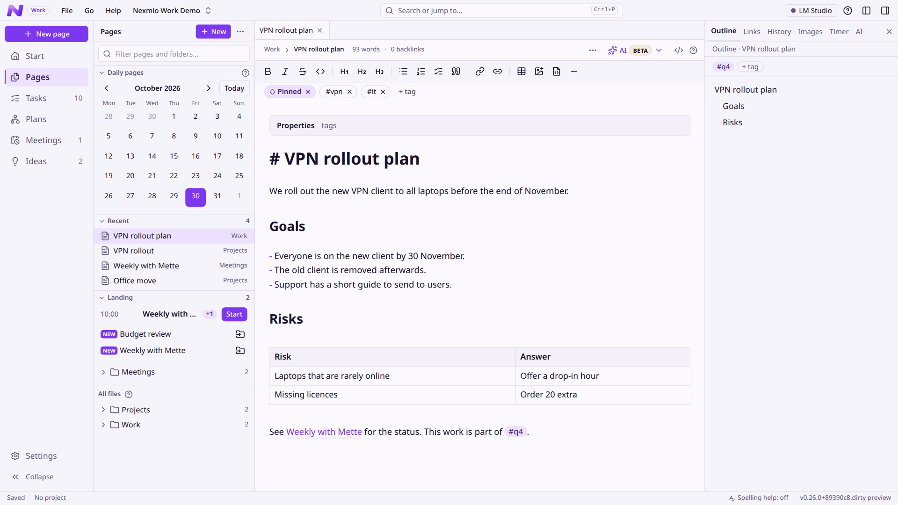
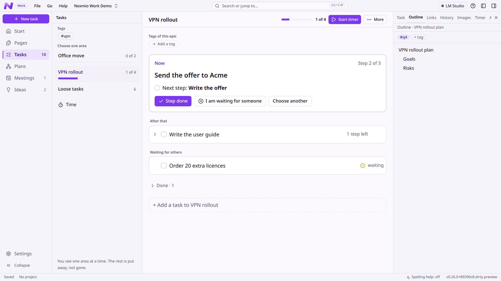
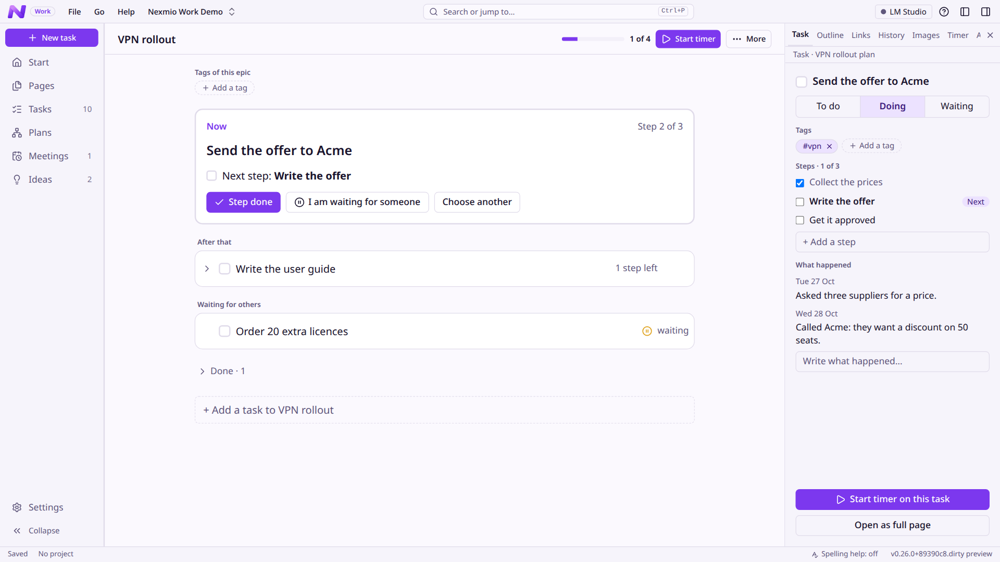
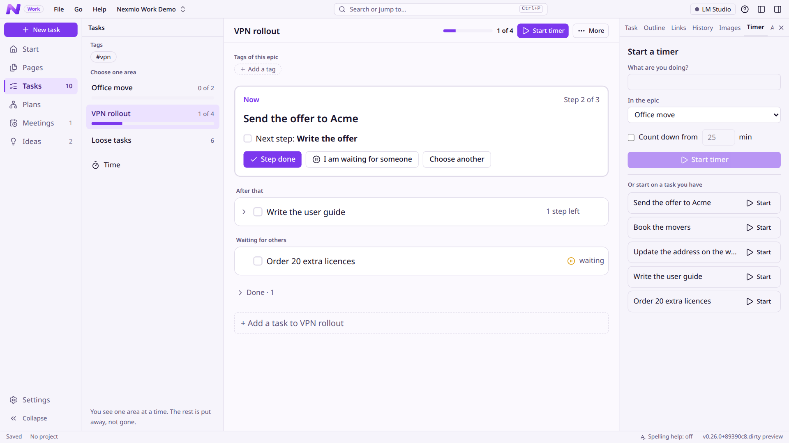
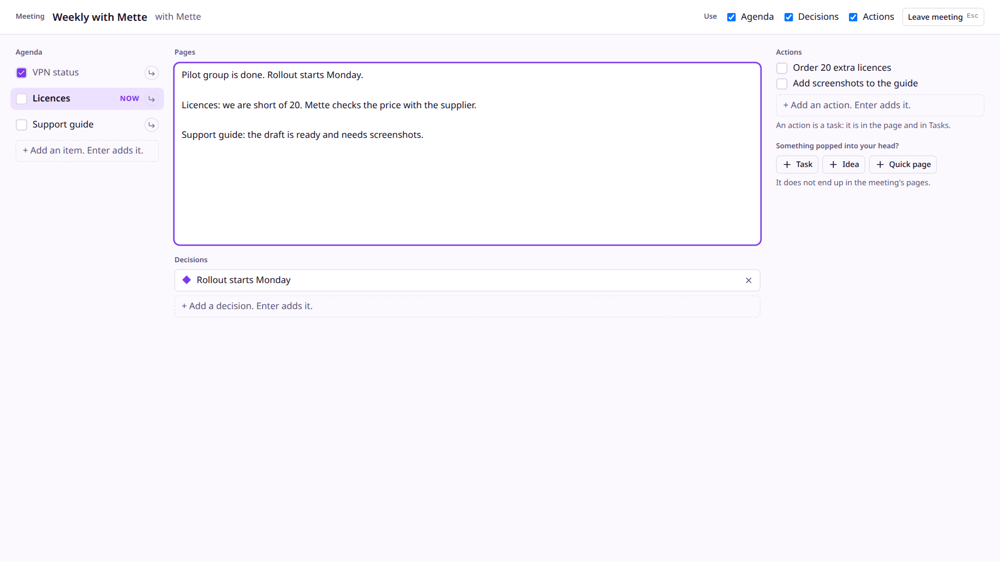
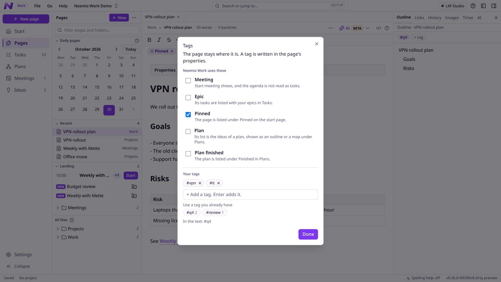
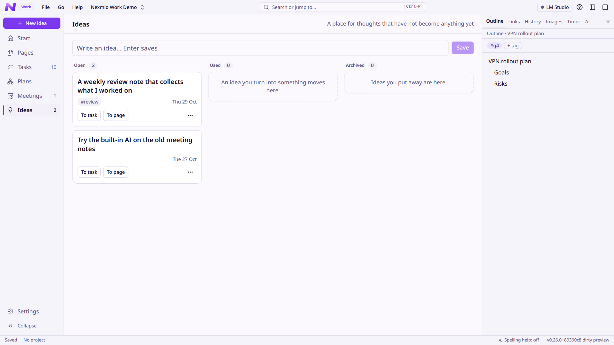
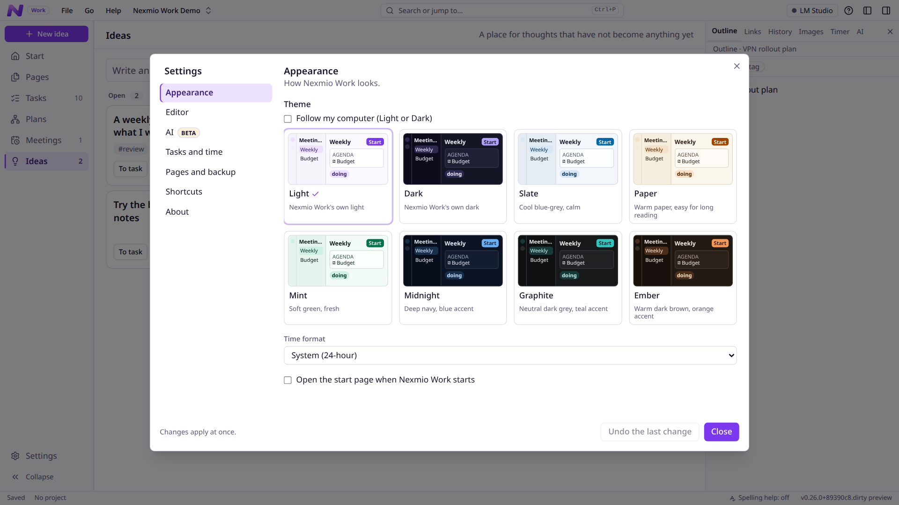
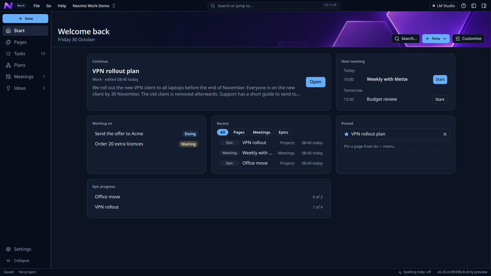

# Nexmio Work

> **Beta.** Nexmio Work is under active development. It works, but expect rough edges, and keep a backup of important pages.

Nexmio Work keeps your pages as plain Markdown files, with tasks, plans, meetings and an AI that runs on your own computer and only ever suggests.

The short overview, with downloads, is on the website: **https://work.nexmio.com/**. This page is the longer, technical one: what Nexmio Work does, how your pages are stored, how to install it and set up the AI, and how to build it.

<p align="center">
  
</p>

## What it is built around

- **Plain files.** Your pages are normal `.md` files in normal folders. A vault works without Nexmio Work. Open your vault in any other editor, any day. There is no database to export and no format to escape from.
- **Nothing is lost.** Every vault is a local Git repository. Every change is saved in a built-in Git history. Bring back any version of a page, or a page you deleted.
- **You are in control.** The AI never changes a page on its own. Every change is a proposal you review. You go through it file by file, and nothing is written until you accept it.
- **Your pages stay local.** The AI reads your pages only on your own machine. A cloud AI is possible, but only after you say yes, and never in a project you lock to local. Nexmio Work does not phone home. There is nothing to sign up for. See [PRIVACY.md](PRIVACY.md).
- **Works without AI.** Everything that is not AI (pages, tasks, meetings, ideas, tags, search, history) works the same when no AI is running. An AI button that cannot work is greyed out and says why.

There is nothing to assemble: no plugins to find, install or keep in step with each other.

## Nexmio Work and Nexmio Work Preview

Nexmio Work comes in two editions, and every new version goes to both. **Nexmio Work Preview** gets each version first, and **Nexmio Work** gets the ones the owner has made Stable.

- **Nexmio Work:** The calm version: tested, and updated less often.
- **Nexmio Work Preview:** The newest features, as they are built. It changes often.

It can be installed next to Nexmio Work, and your pages are plain files in both. Preview has its own settings folder, which it fills with a copy of the Nexmio Work settings the first time it starts. Vault formats only ever grow (new properties, never a changed old one), so both editions read the same vault. How a release is made is in [docs/RELEASING.md](docs/RELEASING.md). Bugs and ideas are welcome: see [SUPPORT.md](SUPPORT.md), or use **Help → Report a bug…** in the app.

Nexmio Work never looks for updates by itself and sends nothing. Use Help → Check for new version… in the app to see if a newer version is out. It opens the releases page in your browser.

## Features

**Writing**

- A live-preview Markdown editor with a formatting toolbar, tabs, a split view, a table editor, Mermaid diagrams, a Markdown source view (`Ctrl/Cmd+Alt+M`), pictures with a size bar, and `[[wiki-links]]` with autocomplete and link updates when a page is renamed or moved.
- A new page is named by its title. Names Windows cannot keep (a dot at the end, `CON`, `NUL`, `\ / : * ? " < > |`) are refused on every system, so a vault works everywhere.
- Daily pages in a calendar at the top of the file panel, and **Trace my work**: one line a day under "Worked on" for each page and task you worked on (off by default).
- A **start page** you build yourself from widgets (Continue, Recent, Pinned, Write it down, Search and ask, Next meeting, Working on, To sort, Areas, Changed since yesterday, Epic progress).
- Eight themes: Light, Dark, Slate, Paper, Mint, Midnight, Graphite and Ember, or follow the computer.
- **Reading** settings: line spacing, letter spacing, font, and **Follow the line**, which dims every line but the one you are in. A choice shows at once and Cancel puts it back.

**Tasks and ideas**

- A task is a checklist line in any page. Nexmio Work reads them in every page and shows an outline of **epics** you can fold, each with its progress. A page is an epic when it has the tag `epic`.
- A task has steps (indented checklist lines), a page, a status (Doing, Waiting, Dropped), a day it was made and a log of what happened. **Break it down** lets the AI propose steps you choose from. A **timer** in the right panel writes the time on a task as a line in its log, **Time** shows what each tag and task took, and tasks and epics can have the same tags as pages.
- A task that is **Waiting** can say who or what it waits for, and which other task it waits for. That task says which tasks wait for it, and the waiting one says **Ready** when it is done.
- The task list shows one epic at a time: the task to do now with its next step, the ones after it, the ones that wait for others, and the done ones folded away.
- A task can point at a page with a `[[wiki-link]]` in its own line. Tasks and steps can be put in your own order.
- **Write it down** from anywhere (`Ctrl/Cmd+Shift+N`): a quick page, a task or an idea, each in its own small box. Ideas are a list you turn into a task or a page later.
- **A taskbar helper (Windows, off until you turn it on).** An icon in the taskbar and keys that work in every program: write something down, and say where you left off. You choose the keys under Settings → Pages and backup, and the settings tell you if another program uses them. Nexmio Work can stay in the taskbar when the window is closed. On other systems it is greyed out.

**Meetings**

- A meeting is a page with the tag `meeting`. The Meetings area has a calendar, then Today, Upcoming and Past, and a meeting screen to write in while you talk.
- The pages are one text for the whole meeting. **Agenda**, **Decisions** and **Actions** are parts you turn on, in the meeting or when you make it. An action is a task, so it is also in Tasks. **Prepare next meeting…** carries over what was not reached.
- A time is picked from a list of every quarter of an hour, or typed (`14:30`, `1430`, `2:30 pm`).

**Tags and search**

- Tags are written in a page's properties (`tags: [vpn]`) or as `#vpn` in the text, and they are the same tag. You choose your own tags; Nexmio Work has three of its own, **Meeting**, **Epic** and **Pinned**, which change what Nexmio Work does with the page and are shown apart, with what each one does. Meeting and Epic are written in the page; a pin is kept in `.vault/meta.json`.
- Full-text search with `tag:` and `path:` filters, and optional search by meaning with a local embedding model. **Answer from my pages** answers a question from the pages that fit.

**History and AI**

- Version history per page: compare, restore, recover deleted pages. Every AI change is a commit and can be undone.
- AI on selected text in a page **and in every text box** (fix spelling, rewrite, shorten, translate, explain, draw as a diagram and more), **In short** for a whole page (the main points and the things to do, and you tick which become tasks), AI commands for a whole page or folder (spelling, structure, summary, a title and tags, sort into folders), skills that Nexmio Work carries out page by page, and a chat that searches and reads your pages to answer. Nexmio Work checks every change a skill makes (links, tags, numbers, dates, code) before it is offered.
- **Test it** under each AI in Settings → AI asks one short question, with none of your pages, and shows the answer or the error in plain words. The built-in AIs are marked Beta.
- **Spelling help** that marks misspelt words in the language of the text and never changes anything by itself.
- Projects: a folder with its own tree, its own AI and a page for the AI about the project.
- Import from a folder (for example a OneNote export, see [docs/IMPORT-ONENOTE.md](docs/IMPORT-ONENOTE.md)) and export to HTML, Word and PDF.

<table>
  <tr>
    <td width="50%"></td>
    <td width="50%"></td>
  </tr>
  <tr>
    <td></td>
    <td></td>
  </tr>
  <tr>
    <td></td>
    <td></td>
  </tr>
  <tr>
    <td></td>
    <td></td>
  </tr>
  <tr>
    <td colspan="2"></td>
  </tr>
</table>

## How your pages are stored

Everything is a Markdown file; Nexmio Work adds a few lines of properties at the top of a page and nothing else.

```markdown
---
tags: [meeting, vpn]
meeting: 2026-10-30 10:00
with: [Mette]
parts: [agenda, decisions, actions]
---

# Weekly with Mette

## Agenda

- [x] VPN status
- [ ] Licences

## Notes

Pilot group is done. Rollout starts Monday.

## Decisions

- Rollout starts Monday

## Actions

- [ ] Order 20 extra licences made:2026-10-30
```

- **Tasks.** `- [ ] Send the offer status:doing made:2026-10-26 #vpn [[Offer to Acme]]`. Indented checklist lines are the steps, indented dated list items (`- 2026-10-28 Called Acme`) are the log, and indented text is the task's note. Nexmio Work changes the page's own lines, so the file stays readable in any editor. What a waiting task waits for and the history of its status are not in the line: they are in `.vault/meta.json`.
- **Epics.** A page with the tag `epic`. **Ideas** are dated lines in a hidden page `Ideas.md` in the vault root.
- **Tags.** In `tags:` or as `#tag` in the text. Nexmio Work's own tags are `meeting`, `epic` and `pinned`; every other tag is yours. A rewrite by the AI never adds or takes away Nexmio Work's tags.
- **Meetings.** The properties above; `parts:` says which of Agenda, Decisions and Actions the meeting has (a meeting without it has all three).
- **The vault.** `.vault/` holds the vault's settings, templates, your own order (`order.json`) and what Nexmio Work keeps outside your pages (`meta.json`: the pinned pages, what tasks wait for and the history of their status), all plain text and committed; the saved chats and the embedding index are kept there too but are not committed. The history is a normal Git repository in `.git/`.

## Language

The app itself (menus, buttons, help and documentation) is in **English**. The AI answers in the language you write in, or in the language you choose under **Settings → AI**, so you can write your pages and talk to Nexmio Work in your own language. How well it does that depends on the model you choose. The built-in models (Gemma 4) have been tried by the author in both **Danish and English** and work as expected. Other languages, and models you add yourself, may vary.

## Install

Download the build for your system from the **Releases** page. There are builds for Windows and Linux. A macOS build is not made for now, because it cannot be tested.

- **Windows 10/11:** run `NexmioWork_<version>_x64-setup.exe` (there is also a Microsoft Store package; see [docs/MSIX.md](docs/MSIX.md)). It installs for the current user and does not need administrator rights. The installer is not signed, so Windows SmartScreen may warn you: choose **More info → Run anyway**.
- **Linux:** run the `.AppImage` (`chmod +x Nexmio Work_*.AppImage && ./Nexmio Work_*.AppImage`), or install the `.rpm`.

## Set up the AI

### Option A: the built-in AI (no other program needed)

Open **Settings → AI** and choose **Built-in AI · llama.cpp** (Windows and Linux; not in the Microsoft Store version yet). It runs on the graphics card (Vulkan) or the processor. Choose a model and press **Download**, then press **Load AI** in the status bar. **Unload AI** unloads the model and frees the memory.

### Option B: LM Studio

1. Install [LM Studio](https://lmstudio.ai) and download a model that supports tool calling.
2. In LM Studio's **Developer** tab, load the model and start the local server (`http://localhost:1234/v1`).
3. In Nexmio Work open **Settings → AI → LM Studio, or another AI on this computer**, load the models, pick one and press **Test connection**.

Give the model a context length of at least 16k in LM Studio, and use the same value in Nexmio Work's settings.

### Cloud AI, only if you choose it

A cloud service with an OpenAI-compatible interface can be the app's AI when nothing on the computer is good enough. Nexmio Work first says what is sent and that it is your responsibility, and uses it only after you tick "I understand". The status bar shows **Cloud AI** while it is on, and a project marked **Local AI only** never uses it.

## Build from source

You need [Rust](https://rustup.rs), Node.js 22 with `pnpm`, and the [Tauri system dependencies](https://tauri.app/start/prerequisites/) (on Windows: Visual Studio Build Tools with the C++ workload).

```bash
pnpm install
pnpm tauri dev        # run the app
pnpm tauri build      # build an installer for the current system
pnpm check            # everything CI runs: format, lint, types, tests, clippy
```

Step-by-step instructions for Linux and Windows are in [docs/START-GUIDE.md](docs/START-GUIDE.md).

**Releases.** Pushing a tag (`pnpm release:tag`) makes GitHub Actions build Nexmio Work Preview at once (installers and the Microsoft Store package) and publish it as a pre-release. When a Preview is good enough, `pnpm release:stable` makes it Nexmio Work: built the same way, sent to the Store and made the latest release. The tag must match the version in `package.json`. The website is the folder `site/`, published by `.github/workflows/pages.yml`; its download buttons follow the GitHub releases by themselves. The steps are in [docs/RELEASING.md](docs/RELEASING.md).

**How the app is made.** Tauri 2 with a Rust backend and a React 19 and TypeScript frontend. [docs/AREAS.md](docs/AREAS.md) maps the app into areas and the files that belong to each; every change starts from a brief, has a change plan and ends with a change report (`pnpm areas report`).

## More

- [docs/START-GUIDE.md](docs/START-GUIDE.md): getting started
- [docs/UX-GUIDE.md](docs/UX-GUIDE.md): how every screen looks and works
- [docs/MANUAL_TESTS.md](docs/MANUAL_TESTS.md): the manual test checklist
- [docs/DECISIONS.md](docs/DECISIONS.md): design decisions
- [docs/IMPORT-ONENOTE.md](docs/IMPORT-ONENOTE.md): moving pages from OneNote
- [docs/MSIX.md](docs/MSIX.md) and [docs/STORE-LISTING.md](docs/STORE-LISTING.md): the Microsoft Store package
- [docs/shared-facts.json](docs/shared-facts.json): the sentences the website and this page say in the same words
- [PRIVACY.md](PRIVACY.md): what Nexmio Work does with your data (nothing leaves your computer unless you choose it)
- [CHANGELOG.md](CHANGELOG.md): what changed in each version
- [CLAUDE.md](CLAUDE.md): how the app is built and changed; [docs/history/SPEC-v1.md](docs/history/SPEC-v1.md): the original v1 specification, with later changes in DECISIONS.md

## Licence and your own version

Nexmio Work is free to use and change (Apache-2.0 with the Commons Clause). It may not be sold. You may use it privately and in a company, and share your own version under the [Apache License 2.0 with the Commons Clause](LICENSE). You may not sell it, or sell a service whose value comes mainly from it. If you share your own version, keep the [NOTICE](NOTICE) file and the copyright with it, say which changes you made, and link to this project (https://github.com/nexmio/work.nexmio.com). Nexmio Work was earlier called Mimer; copies of Mimer keep the licence they were given.

Built with Tauri 2, React and Rust.
