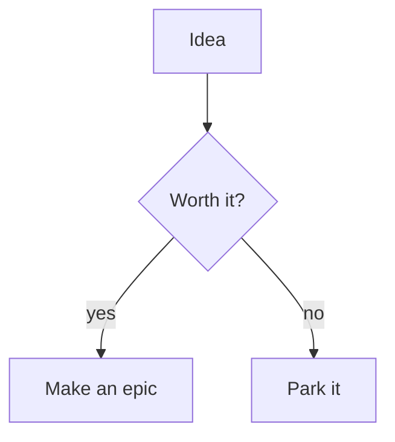
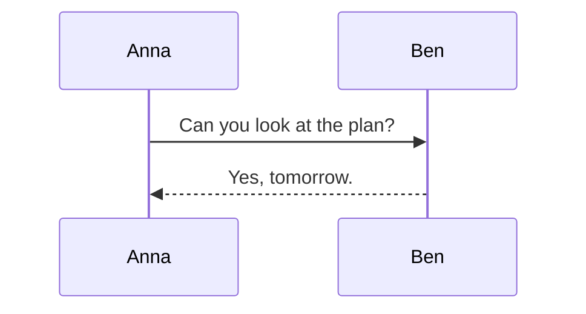
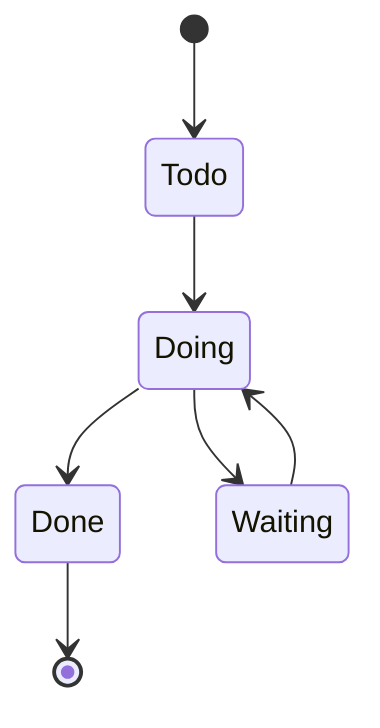
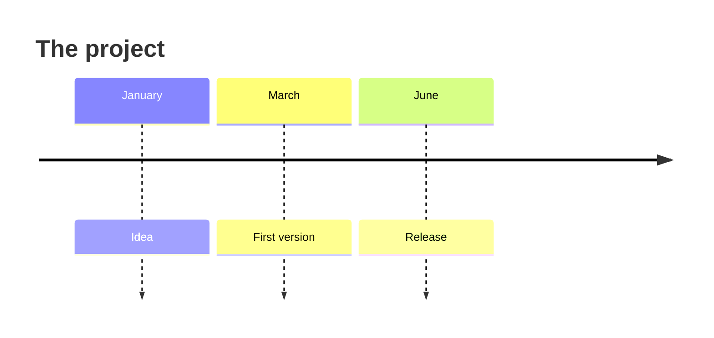
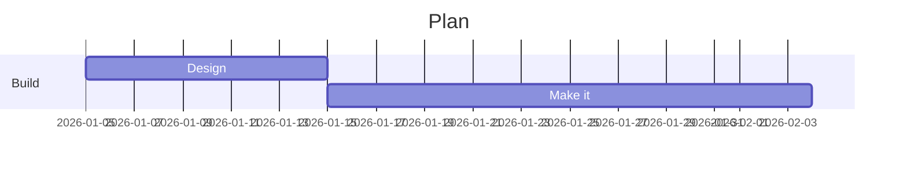
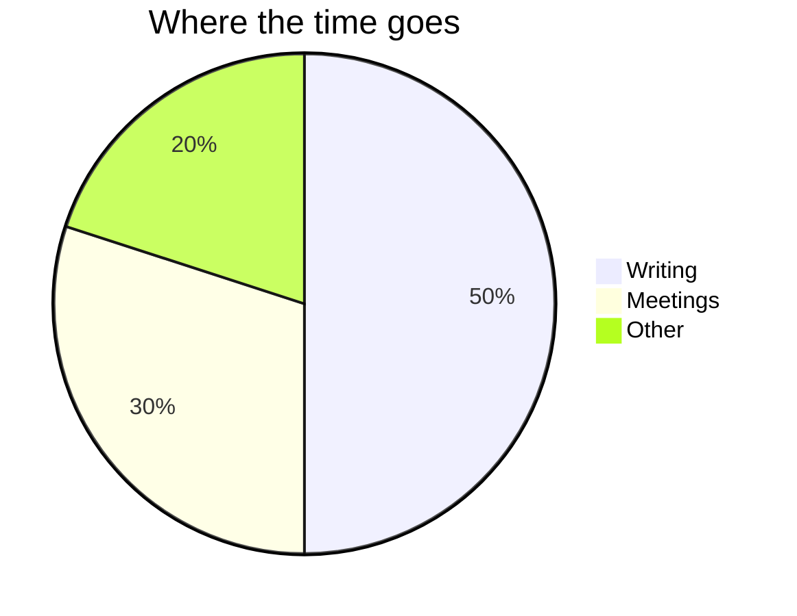
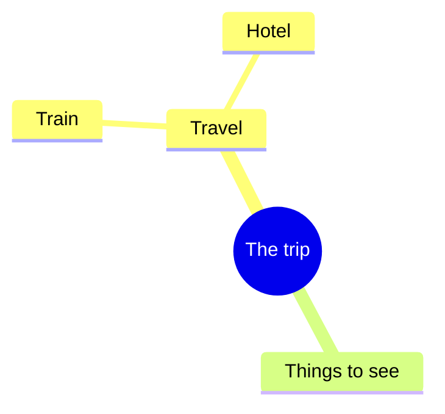

## Draw a diagram yourself (Mermaid)

You do not need the AI to make a diagram. A diagram is a block of text in a page, and Nexmio Work draws it while the cursor is somewhere else. Click the picture to edit the text again.

**How to start:** write three backticks and the word `mermaid`, then the diagram, then three backticks. Copy one of the examples below and change the words. If something is wrong, the picture says what and shows the code, so you can fix it.

### A flow (flowchart)

`TD` is top to bottom, `LR` is left to right. A box is `[text]`, a question is `{text}`, and `-->` is an arrow. A word on an arrow goes between `--` and `-->`.

````

````

### A talk between people or parts (sequence)

````

````

### The steps a thing goes through (state)

````

````

### A timeline of events

````

````

### A schedule (Gantt)

````

````

### Shares of a whole (pie)

````

````

### A mind map

````

````

### Tips

- Start with a few boxes and add more. Give each box a short name.
- Use quotes round a text with special signs: `A["Cost (DKK)"]`.
- Indent with two spaces. A line that starts with `%%` is a comment.
- A diagram is plain Markdown: GitHub and other tools draw it too.

### More to learn

Mermaid has a short guide and a page for every kind of diagram, with many more examples:

- Start here: https://mermaid.js.org/intro/
- All kinds of diagrams and their text: https://mermaid.js.org/syntax/flowchart.html (the list is in the menu on the left)
- Try a diagram in your browser: https://mermaid.live
