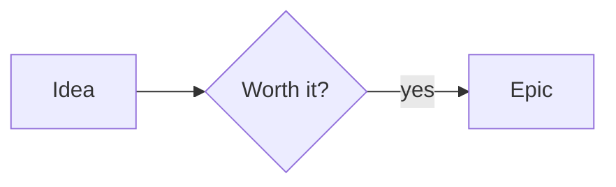

1. Open a page and write.
2. Select text and press a button above the page: bold, heading, list or link.
3. Press the **table** button to add a table.


<!-- more -->

## The toolbar

Above every page is a toolbar. Select some text and click a button, or click first and type after. Clicking the same button again removes the formatting.

- **Text:** bold, italic, strikethrough, inline code.
- **Headings:** H1, H2, H3. Click the same heading again to go back to normal text.
- **Lists:** bullet list, numbered list, task list (with check boxes), quote.
- **Link** and **Link to a page** (see _Links and index pages_).
- **Table**, **Insert image**, **Code block**, **Horizontal line**.

## You do not have to know Markdown

Nexmio Work shows your page nicely while you write: `**bold**` appears bold, and the marks are hidden when the cursor leaves the line. The buttons add the marks for you.

| You type     | You get                       |
| ------------ | ----------------------------- |
| `# Title`    | a big heading                 |
| `**word**`   | **bold**                      |
| `_word_`     | _italic_                      |
| `- item`     | a bullet list                 |
| `- [ ] task` | a task you can tick           |
| `> quote`    | a quote                       |
| `#tag`       | a tag you can click to search |

Nexmio Work's own tags (`meeting`, `epic`, `pinned`, `plan`) do nothing written as `#tag` in the text; they are kept in the page's properties. Use the page's **Tags** or its menu, or write one in the text and press the button that appears next to it in the tags line (for example **Make this page a meeting**). The `#` suggestions do not offer them.

## Tables

Click **Insert table** (or press **Ctrl/Cmd+Alt+T**). Click in a cell and type. A toolbar above the table adds or removes rows and columns and sets alignment. Press **Tab** to go to the next cell.

## Tabs and two pages side by side

Every page you open gets a tab. Close with the **×** or **Ctrl/Cmd+W**. Press **Ctrl/Cmd+\\** to show two pages next to each other.

## See the Markdown

Click the **</>** button at the right end of the toolbar (or **Go → Show Markdown source**, or **Ctrl/Cmd+Alt+M**) to see the page exactly as it is stored: every `#`, `**` and `[[...]]` visible, in a monospace font. Click the eye button to go back to the formatted view. Nexmio Work remembers your choice. Nothing in the page changes when you switch.

## Reading comfort

**Settings → Editor → Reading** changes how the text looks while you read and write: the space between lines (Normal, Roomy, Extra roomy), the space between letters, the font (System, Serif or Monospace) and **Follow the line**, which keeps the line you are in clear and makes the others a little dimmer. A choice shows at once, in the preview and in every page, and is kept; **Undo the last change** puts the last one back. **Back to the defaults** resets them. The text size and the line width are just above.

## Diagrams

Select a text that describes a flow and choose **Draw as a diagram** in the AI menu: Nexmio Work proposes a diagram next to the text, and **Add under the text** writes it as the Mermaid block below, which you can edit as text.

A fenced block written with the language `mermaid` (or with no language, when its first line starts a diagram such as `graph TD`) is drawn as a diagram while the cursor is somewhere else; click the picture to edit the code. It is plain Markdown (GitHub draws it too), and it is drawn on this computer. A diagram with a mistake shows what is wrong and its code.

More examples (flows, sequences, timelines, schedules, mind maps) are in **Diagrams (Mermaid)** in this guide.

````

````

## Markdown in other boxes

The boxes where you write more than one line (the page of a task, an epic or an idea, the log of a task, the notes of a meeting) work like a small page: `**bold**` shows as bold when the cursor leaves the line, lists continue with Enter, **Tab** and **Shift+Tab** indent, and **Ctrl+B** and **Ctrl+I** make the selection bold or italic. A log line stays one line. Boxes for one line (a title, a task, a step) are plain text.

## Writing in a table

Click a cell to write in it. **Enter** goes to the cell below and **Tab** to the next one. **Shift+Enter** makes a new line inside the cell, and lines that start with `-` become a bullet list; in the Markdown the new line is written `<br>`. Drag the right edge of a header cell to make a column wider or narrower: the column next to it gets or gives the room, and the last column's edge makes the whole table wider. Double-click an edge for automatic widths. The widths are kept by Nexmio Work, not in the page, so other programs share the room their own way. Ctrl/Cmd+click opens a link in a cell. The buttons over the table add and remove rows and columns, and **Markdown** shows the table as text.
